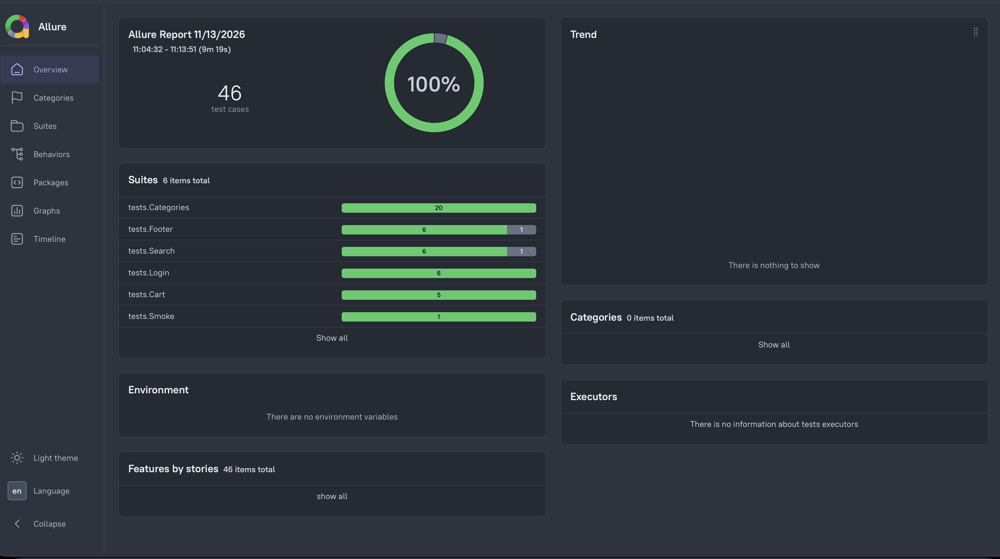

# MusicGate Playwright Automation

UI automation testing framework for the MusicGate e-commerce website using Playwright, Pytest, Page Object Model (POM), Allure Reports and GitHub Actions CI.

---

# About The Project

MusicGate is an Israeli e-commerce website and physical music store focused on musical instruments, amplifiers, keyboards, percussion instruments, audio equipment, and accessories.

This project was created in order to practice and improve real-world UI automation testing skills on a live WooCommerce-based website with dynamic user interactions and complex navigation behavior.

The framework includes automated coverage for:
- Homepage
- Product Search
- Login Functionality
- Shopping Cart
- Product Categories (mega menu navigation)
- Footer Navigation

**46 automated UI tests** - all running without SlowMo:
- 44 passed
- 1 xfail - a known bug on the site (see [Bugs Found](#bugs-found))
- 1 skipped - a feature that was removed from the site

---

# Automation Demo Video

A short trailer and a full run of the MusicGate Playwright Automation project.

▶ [Trailer (2 Minutes)](https://www.youtube.com/watch?v=L8lnFksDMEA)

▶ [Full Test Run (11 Minutes)](https://www.youtube.com/watch?v=8svUozZw1XI) - all 46 tests, final results and the Allure report

---

# Technologies Used

- Python
- Playwright
- Pytest
- Allure Reports
- Page Object Model (POM)
- GitHub Actions (CI)

---

# Project Structure

```
MusicGateAutomation/
├── POM/                         # Page Objects
│   ├── base_page.py             # BasePage - shared logic for every page
│   ├── cart/
│   ├── footer/
│   ├── instruments/             # guitars, amplifiers, keyboards, percussion, wind
│   ├── login/
│   └── search/
├── tests/
│   ├── Cart/
│   ├── Categories/
│   ├── Footer/
│   ├── Login/
│   ├── Search/
│   └── Smoke/
├── conftest.py                  # global timeouts for a slow live site
├── pytest.ini                   # test paths + "smoke" marker
└── .github/workflows/           # GitHub Actions CI
```

---

# Framework Architecture

The project follows the Page Object Model (POM) design pattern in order to improve:
- Readability
- Maintainability
- Reusability

Every page class inherits from **BasePage**, which handles opening pages and the site's loading behavior in one place. Tests only call clear actions (for example `cart_page.add_to_cart(...)`) and contain no raw locators.

Other techniques used:
- `@pytest.mark.parametrize` - one test function covers several subcategories / search inputs
- Pytest fixtures - shared setup (for example "cart with a product already added")
- Playwright auto-waiting with `expect` - no hard-coded sleeps

---
# Allure Report



--- 

# Continuous Integration

A GitHub Actions workflow runs the **smoke tests** (`pytest -m smoke`) on every push.
Smoke tests are a small set of critical checks: the homepage loads, the login page opens, search works, and a product can be added to the cart.

Allure results from each CI run are saved as a downloadable artifact.

**Note:** the site is protected by Cloudflare, which sometimes blocks cloud servers such as GitHub Actions and shows a "security verification" page instead of the site. The framework detects this page and marks the tests as **skipped** with a clear reason, instead of trying to bypass the protection. The full suite is run locally.

---
# Challenges and How They Were Solved

This project was built on a real, live website. The goal was not only to validate functionality, but to understand **why** tests fail on a real site and fix the root cause.

## The Loading Screen (WP Rocket)

The site uses WP Rocket, which delays loading JavaScript until the user moves the mouse or scrolls. Until then, a loading overlay blocks every click.

- **Earlier version:** the tests were slowed down with SlowMo- **Root cause fix:** BasePage simulates a mouse move and scroll after opening each page, then waits for the overlay to disappear
- **Result:** all tests run at full speed without SlowMo

## Mega Menu and Categories

The category menu opens on hover and expects a second click to navigate.
The page object hovers, waits for the menu to report it is open (`aria-expanded="true"`), and only then clicks.

## Shopping Cart (AJAX)

"Add to cart" sends the product to the server in the background, without reloading the page. Moving to the cart too early produced an empty cart - a **flaky test**.
The fix waits for the server's response to the add-to-cart request before continuing.

## A Live Site Changes

Some failures were not bugs in the tests or in the site, but changes to the site:
- A product used in the tests was removed (page returns 404)
- Another product went out of stock (no "add to cart" button)
- A button label changed from "חיפוש" to "חפש"
- Some URLs end with `/` and some do not

Each failure was investigated in the browser (Inspect / Network) before deciding whether to fix the test or report a bug.

## Out of Scope

Checkout and registration were intentionally excluded: they involve multiple redirects, session state and highly dynamic WooCommerce behavior that need a more advanced setup (test accounts, data cleanup).

---

# Bugs Found

| Bug | Status in the framework |
|---|---|
| On the Hebrew site, the search results title is shown in English ("Search Results for ...") | Documented with `xfail` |

Removed feature (not a bug): the Instagram link was removed from the footer because the account no longer exists - the test is marked `skip` with the reason.

---

# Future Improvements

- Login tests: verify the actual error message, not only that the form is still shown
- Run tests in parallel to reduce execution time
- Publish the Allure report to GitHub Pages
- API tests

---

# Personal Interest

I have a personal interest in musical instruments and personally purchased musical equipment from the physical MusicGate store, including:
- A classical guitar
- Guitar accessories
- An electric guitar amplifier

I also own:
- Two classical guitars
- One acoustic guitar
- One electric guitar

This project combined my interest in music with my passion for software QA and automation testing.

---

# Running The Tests

## Supported Platforms

- Windows
- macOS
- Linux (including Ubuntu)

## Install Dependencies

```bash
pip install -r requirements.txt
playwright install
```

## Run All Tests

```bash
pytest
```

## Run Only Smoke Tests

```bash
pytest -m smoke
```

## Watch The Browser

```bash
pytest --headed
pytest --headed --slowmo 500   # slow down each action
```

---

# Allure Reports

Run tests and save results:

```bash
pytest --alluredir=allure-results --clean-alluredir
```

Open the report:

```bash
allure serve allure-results
```
